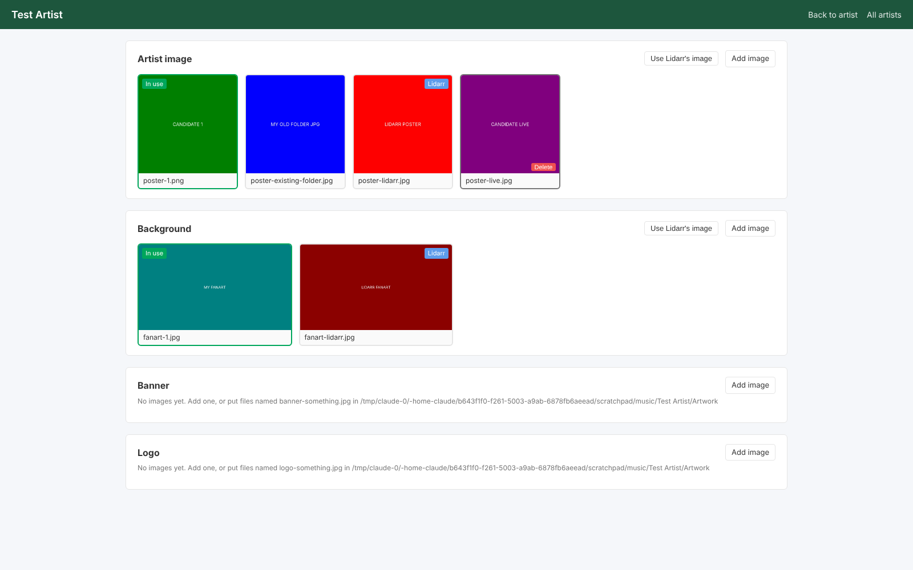
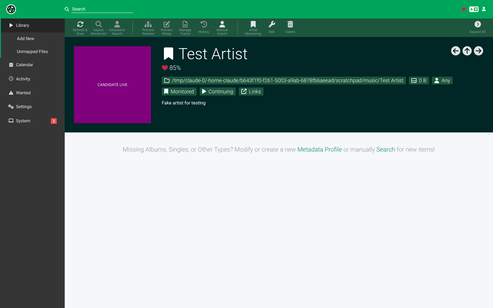

# Encore

A Lidarr plugin that adds extras around your music library. Each feature can be turned on or off on its own.

| Feature | Status | Turn on in |
|---|---|---|
| Artist Art: several images per artist, chosen inside Lidarr | Ready | Settings → Metadata → Artist Art |
| Music Videos: find, download and organize music videos into artist folders | Ready | Settings → Metadata → Music Videos |

## Install

1. Use a Lidarr build that supports plugins (the `develop`/plugins branch).
2. Go to **System → Plugins**, paste `https://github.com/noplexzone/Encore` and install. Restart Lidarr.
3. New releases show up on the same page as updates.

# Artist Art

Keeps several images per artist in the artist's own folder and lets you choose which one to use from inside Lidarr.



## What it does

- Every artist folder gets an `Artwork/` subfolder that holds all candidate images: posters, fanart, banners and logos.
- On first use, images already in the artist folder (`folder.jpg`, `artist.jpg`, `fanart.jpg` and so on) are copied into `Artwork/`. Lidarr's own downloaded images are also saved there as `poster-lidarr.jpg` etc., so you can always go back to them.
- The **Artwork** page in Lidarr (`/artwork`, also reached from the **Change image** button that appears when you hover over an artist's image) shows every candidate. Click one to use it, or upload new ones.
- The chosen image is written to the artist folder for media servers (`artist.*` and `folder.*` for the poster, `fanart.*`, `banner.*`, `logo.*`). It is also written into Lidarr's own image cache, so the Lidarr UI shows it too and Lidarr's metadata refresh does not undo it.
- Navidrome picks up `artist.*` with its default `ArtistArtPriority`.



## Turning it on

1. Go to **Settings → Metadata** and add **Artist Art**. Saving it turns the feature on.
2. Optional: set **Settings → General → Application URL** (for example `http://lidarr.local:8686`) to also get an Artwork link under each artist's Links. You can also set **Picker Address** in the feature's advanced settings instead.

## Using it

Open an artist, hover over the artist image and click **Change image**, or go to `http://<lidarr>/artwork` and choose an artist.

- Click a thumbnail to use it. The badge shows which image is in use.
- **Add image** uploads a .jpg, .png or .webp file (up to 50 MB) into the artist's `Artwork/` folder.
- **Use Lidarr's image** goes back to the image Lidarr downloaded.
- Hover a thumbnail to delete it. The image in use can't be deleted.

You can also drop files into `Artwork/` yourself. Files are grouped by name prefix:

| Type | File names |
|---|---|
| Poster | `poster*`, `artist*`, `folder*` |
| Fanart | `fanart*`, `backdrop*`, `background*` |
| Banner | `banner*` |
| Logo | `logo*`, `clearlogo*` |

A prefix must be the whole name or be followed by `-`, `_`, `.` or a space, for example `poster-live.jpg` or `fanart 2.png`.

The selection is saved in `Artwork/artwork.json` inside the artist folder, so it survives a Lidarr reinstall.

## Settings

| Setting | Default | Meaning |
|---|---|---|
| Candidate Folder | `Artwork` | Subfolder of the artist folder that holds candidates |
| Write artist.jpg | on | Write the chosen poster as `artist.*` (Navidrome) |
| Write folder.jpg | on | Write the chosen poster as `folder.*` (Plex, Jellyfin, Kodi) |
| Write Other Images | on | Write `fanart.*`, `banner.*`, `logo.*` |
| Keep Lidarr's Images | on | Keep a copy of Lidarr's own images as `*-lidarr.*` candidates |
| Artwork Link | on | Add an Artwork link to each artist's Links |
| Picker Address (advanced) | empty | Overrides Application URL for that link |

## Known limits

- After a metadata refresh, Lidarr briefly shows its own image again before the plugin puts yours back (usually under a second).
- Lidarr's artist page only shows types its metadata already has. If Lidarr has no fanart for an artist, a chosen fanart is still written to the folder but won't appear in Lidarr.
- The Artwork page is a separate page served by Lidarr, not a tab inside the artist page. Plugins can't add to Lidarr's built-in UI.

# Music Videos

Finds each artist's official music videos and downloads them, in the best quality available, into the artist's folder as separate video files with their own audio.

## What it does

- **Finds videos** in three places, best first:
  1. Recordings that MusicBrainz marks as videos and links to YouTube (or Vimeo, Dailymotion).
  2. A YouTube search for MusicBrainz videos that have no link yet.
  3. The uploads of the artist's YouTube channels that MusicBrainz knows about (their own channel and their VEVO channel), keeping only titles that say they are official videos.
- **Downloads** with [yt-dlp](https://github.com/yt-dlp/yt-dlp), taking the best video and the best audio stream separately and joining them with ffmpeg. On YouTube that usually means 4K or 1440p AV1/VP9 when the video has it, and Opus audio.
- **Saves** `Music Videos/<Artist> - <Title>.mkv` in the artist folder, with `<name>-thumb.jpg` and a Kodi-style `<name>.nfo` that Jellyfin, Emby and Kodi read. Files are always `.mkv` or `.mp4`, never `.webm`: Navidrome treats `.webm` and `.mka` as songs, but ignores `.mkv` and `.mp4`. Lidarr ignores them too.
- **Keeps track** in `musicvideos.json` in the video folder, so monitoring and downloaded videos survive a Lidarr reinstall.
- Each artist is searched when it is added and again every 7 days. Videos already found are never offered twice, even from another channel.

## Turning it on

1. Go to **Settings → Metadata** and enable **Music Videos**. Saving it turns the feature on and starts the first searches a couple of minutes later.
2. Encore downloads yt-dlp (and keeps it updated daily), ffmpeg if there isn't one on the system, and deno, a JavaScript runtime YouTube now needs for its full format list. They go in `<Lidarr data folder>/Encore/bin`.
   - On Alpine-based Docker images (for example linuxserver/lidarr), deno has no build, so install a runtime once: `apk add nodejs` (or `deno` if your Alpine has it). Without one, YouTube may only offer low quality formats, and the Videos page says so.
3. Optional: set **Settings → General → Application URL** to also get a Videos link under each artist's Links.

## Using it

Each artist page gets a **Music Videos** section below Albums and Singles that works like them:

- The bookmark on each video monitors or unmonitors it. The bookmark in the section header does all of them at once, and also decides whether videos found later start out monitored.
- The search icon on a video downloads it now. The search icon in the header looks for new videos and downloads the monitored ones that are missing.
- Monitored videos download automatically while the artist is monitored, like albums.

**Manage music videos** at the bottom opens the full page. All artists are at `http://<lidarr>/videos`. On the full page:

- **Search now** looks for new videos straight away.
- Monitored videos download automatically. Turn off **Download Automatically** to pick them yourself with **Download**.
- **Unmonitor** stops a video from being downloaded. **Delete** removes the file and unmonitors it.
- **Add** takes a video address (downloaded whatever its title says) or a channel or playlist address (scanned now and on every search).
- **Play** plays a downloaded video in the browser, if the browser supports its codecs.

## Settings

| Setting | Default | Meaning |
|---|---|---|
| Video Folder | `Music Videos` | Subfolder of the artist folder. Empty puts videos straight in the artist folder |
| File Name | `{Artist Name} - {Track Title}` | Also `{Video Type}` and `{Year}`. For Plex local music videos use an empty folder and `{Track Title}-video` |
| Container | MKV | MKV holds every codec. MP4 also works with AV1/VP9 and Opus but some players are pickier |
| Codecs | Best quality | Most compatible prefers H.264 and AAC, which on YouTube usually means 1080p at most |
| Max Resolution | No limit | Caps the download, for example at 1080p |
| Download Automatically | on | Download found videos straight away |
| Live Videos / Lyric Videos | off | Also get live performances / lyric videos |
| Only Tracks in Library | off | Only videos for songs on albums in Lidarr |
| Write NFO / Save Thumbnail | on | Files for Kodi, Jellyfin and Emby |
| Videos Link | on | Add a Videos link to each artist's Links |
| Search Every (days) (advanced) | 7 | How often each artist is searched again |
| Cookies File (advanced) | empty | A `cookies.txt` from a signed-in YouTube account. Premium accounts get higher bitrate 1080p formats, and age-restricted videos work |
| yt-dlp Path / FFmpeg Path (advanced) | empty | Use your own copies instead of Encore's |
| Extra yt-dlp Arguments (advanced) | empty | Added to every download, for example `--limit-rate 5M` |
| Link Address (advanced) | empty | Overrides Application URL for the Videos link |

## Known limits

- Only one search or download runs at a time, so the first pass over a big library takes a while.
- YouTube's best audio is Opus at about 130 kbps (or 256 kbps AAC/Opus for some Premium formats with cookies). Better copies, such as Blu-ray rips, are not looked for yet.
- MusicBrainz is asked about at most 60 new video recordings per artist per search, to stay within its rate limit. The rest are picked up by later searches.

# Building

```sh
git clone --recursive https://github.com/noplexzone/Encore
dotnet test tests/Encore.Tests/Encore.Tests.csproj -p:AssemblyVersion=0.1.0.0
dotnet build src/Encore/Encore.csproj -c Release -p:Version=0.1.0 -p:AssemblyVersion=0.1.0.0 -o _output
```

Pass `AssemblyVersion` on the command line, not in the project file. It has to apply to the Lidarr projects too, or the plugin binds to Lidarr.Core 10.0.0.x and won't load.

Releases are built by GitHub Actions, either when a `v*` tag is pushed or by running the Build workflow by hand with a version number (Actions → Build → Run workflow). The release asset is `Encore.net8.0.zip`, which is what Lidarr's plugin installer looks for.
